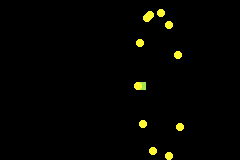

# GBA Orbiter Simulation

A lightweight orbital mechanics simulation built for the **Game Boy Advance (GBA)** using the modern [Butano]engine. This project demonstrates real-time physics updating, sprite management, and dynamic entity spawning/despooling constrained within GBA hardware limitations.

## Features
- **Dynamic Entity Management:** Spawn and despawn up to 30 orbiting sprites on the fly using the Game Boy Advance `A` and `B` buttons.
- **Fixed-Point Arithmetic:** Utilizes Butano's fixed-point math (`bn::fixed`) for numerical stability and high-performance physics calculations.
- **Customizable Orbits:** Interacting center gravity points and orbital trajectories powered by modular movement logic (`center.h`, `orbiter.h`, `movement.h`).

# DEMO

